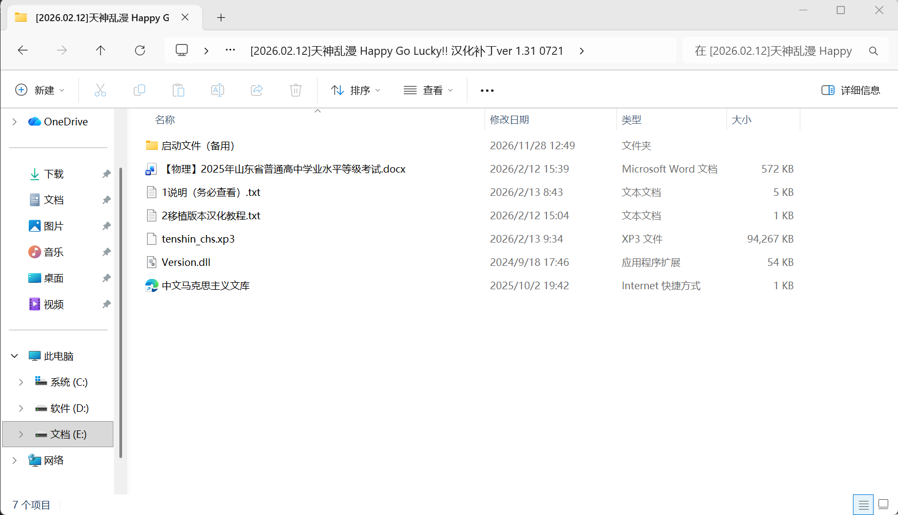
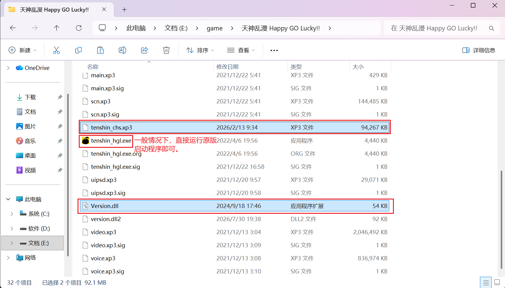
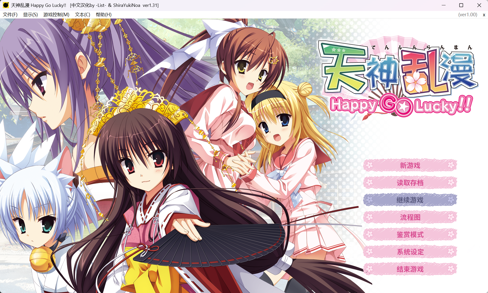
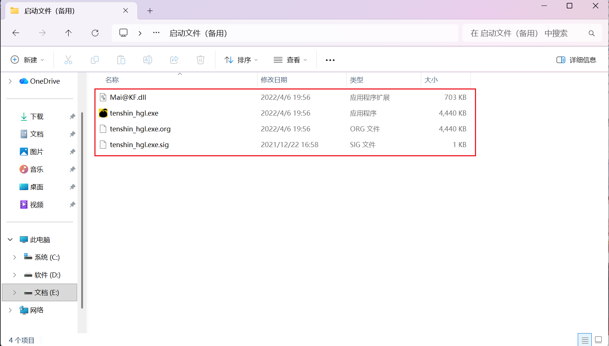
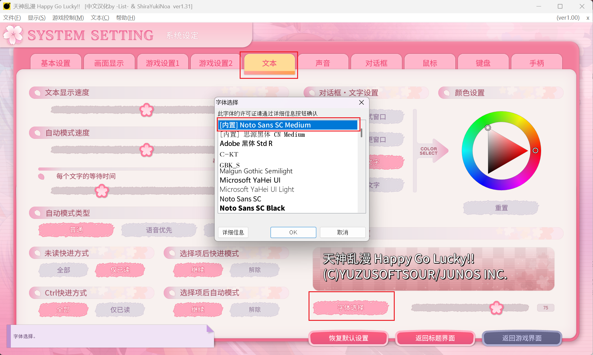

# 《天神乱漫 Happy Go Lucky！！》简体中文汉化补丁

## 声明

问题/BUG反馈可在B站视频评论区下留言。若有新发现bug，后续还会继续发布新补丁。
[bilibili：【【汉化】天神乱漫 Happy Go Lucky！！】](https://www.bilibili.com/video/BV1aP7cznEUL)

简中汉化补丁系列，由-List-和ShiraYukiNoa合作完成。

本补丁仅适用于《天神乱漫 Happy Go Lucky！！》日文实体版，安装本补丁后可实现中文本地化的效果。注意：DMM数字版可能存在不兼容问题！

本补丁游戏文本部分以[@库尼娅](https://space.bilibili.com/4458968)制作的汉化补丁[【【汉化首发】【酸柚子/全年龄/新增角色及CG/1080P重置】天神乱漫 Happy GO Lucky!!】](https://www.bilibili.com/video/BV1MQseeYEQ7)和@妹乃萌汉化小组制作的天神乱漫 Lucky Or Unlucky！？汉化补丁为基础进行人工润色。
系统UI的后期校对由[@-List-](https://space.bilibili.com/700095337)完成。

**任何人均可在个人研究/学习交流的用途下免费获取本补丁和原文件，禁止任何形式的付费交易，我们不会售卖本补丁，也不会对此为任何人承担来自盗卖者嫁接的退款责任。**

如果您通过任何付费渠道获取到本补丁或看到有任何人售卖本补丁和原文件，请立即差评退款且在您力所能及的范围内进行维权。

本补丁仅用于个人学习交流，请于下载后24小时内删除。补丁制作不易，请尊重我们的劳动成果。

*根据《计算机软件保护条例》规定：为了学习和研究软件内含的设计思想和原理，通过安装、显示、传输或者存储软件等方式使用软件的，可以不经软件著作权人许可，不向其支付报酬！

下载时，我们默认您已接受上述许可协议。

## 游戏介绍
主人公・千岁春树的日常是最平稳不过的了。

手机掉下来就掉在水中，钱包是丢了的数字数不清，如果骑自行车必定遇到事故，走在街上会被人找茬

……即使这在他人眼中就是所谓的不幸，但这种程度对于他来说种程度根本不算什么麻烦，只能算普通的日常而已。就这样与没完没了的不幸一起，过着和平（？）生活的春树的身边，“那个”来到了。

某日，突然收到包裹。 没有收件人地址，只贴有一张没有写寄件人，只写着『生物』的贴纸的行李。 即使日常生活充满麻烦的春树，也绝不能想到里面是什么东西。 竟然是一个“女孩子”被邮寄了过来……

这正是，春树所得到的『新的不幸』…………不对，是『初次的幸运』、波澜起伏的故事拉开了序幕。

为了驱除春树的不幸而来到的！自称是“神”的少女如此说道、并且以从麻烦中守护他的名义为由寄宿在他的家里…… 由于她的行动而引来了新的问题，小的麻烦不知何时成了将周围人都卷入的大骚动！

在这乱七八糟的每日中，春树所得到的『幸运』到底能带来什么呢？ 自称是神的少女的真正目的是？围绕着春树的不幸能消失吗？

答案就在这即将开始的骚乱的每一天中！

【文本来源于touchgal】

## 补丁下载安装

最新版本：ver1.31

下载链接1：[鲲GalGame补丁页](https://www.moyu.moe/resource/10634)  解压密码：0721。
下载链接2：[百度网盘](https://pan.baidu.com/share/init?surl=47NzVjcGxRNgk49OUmiiDQ)  提取码＆解压密码：0721。
下载链接3：[OneDrive](https://1drv.ms/f/c/cb59d20e711a9873/IgDQFWVtIFryS4EtTk78D9xRAQ_-HgbY0frs8e9iRTjJi3w?e=W0NIu)  解压密码：0721。

下载后，解压压缩包，你会得到以下文件。

将tenshin_chs.xp3，Version.dll文件复制到游戏根目录下，双击运行原版游戏主程序。

启动游戏后，若能看到中文版本的标题界面，即补丁安装成功。

若原版启动程序无法正常运行，或者打开报错，请参照下面的方法。

**注意：务必备份原版启动程序。**

复制补丁包中“启动文件（备用）”文件夹内的所有内容，粘贴到游戏根目录下。

运行来自补丁包中的新启动程序“tenshin_hgl.exe”，通常都可以正常启动游戏。

补丁内置了“思源黑体M”字体，但默认不会以这个字体显示文本。为获得更好的游戏体验，请在“系统设定”中，点击“文本”选项卡，在文本框设置部分点击“选择字体”，选择“[内置]Noto Sans SC Medium”，点击“OK”，完成显示字体更改。

## 历史汉化版本详情

ver_1.31 汉化：2026.02.12
修正：全部文本内容重新校对，适当增删部分注解。修正部分素材错误内容。
调整：依据目前发现，删除部分改动后影响游玩体验的内容。
优化：嵌字OP动画换源。

ver_1.30 汉化：2025.10.02
汉化：系统菜单栏汉化（部分项没找到对应文件且不常用没有汉化），文本朗读、截图、存档详情编辑、语音文本编辑、立绘鉴赏文本编辑栏、剧本搜索提示等的窗口内容汉化。
修正：修改角色名 龙胆瑠璃→龙胆琉璃，纠正同一单词翻译不同导致出现歧义的文本。调整左下角提示窗部分内容。
优化：嵌字OP动画进行体积压缩，减轻设备播放压力。压缩补丁包体积。

ver_1.20 汉化：2025.06.09
汉化：菜单栏修正补丁部分汉化（虽然基本不可能推送日文修正补丁）。
修正：部分素材排版修正，对部分角色线路文本进行精修。

ver_1.12 汉化：2025.06.05
汉化：龙胆瑠璃线的素材内容修改汉化完成。
修正：修复部分素材中的错字（目前发现的），修正部分文字排版。修复系统设定-声音中卯之花姬、龙胆瑠璃、若叶、苏芳等语音设定时不能播放示例语音。

ver_1.00 汉化：2025.05.31
汉化：系统UI，部分素材内容，剧情文本，OP动画嵌字。

## Staff

CG修改＆嵌字：-List-

程序＆脚本修改＆二次封包：[-List-](https://space.bilibili.com/700095337)

文本：[ShiraYukiNoa](https://space.bilibili.com/4458968) + 人工校对

测试：-List-

OP动画嵌字：-List-

特别感谢：ShiraYukiNoa、妹乃萌汉化小组
